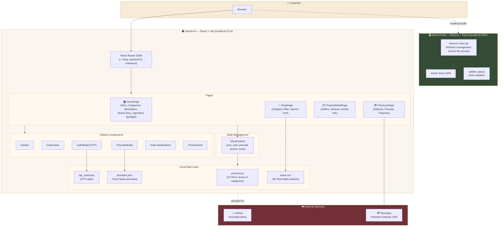

# Mother Nature — Premium Native Foods

> *The First Step in Health.* Native grains, heirloom seeds & cold-pressed oils from the ancient soil of Kanchipuram, Tamil Nadu.

---

## Architecture



---

## Project Structure

```
Mother Nature/
├── src/
│   ├── pages/
│   │   ├── HomePage.jsx          # Hero, categories, bestsellers, brand story
│   │   ├── ShopPage.jsx          # Filterable product grid
│   │   ├── ProductDetailPage.jsx # Gallery, variants, Ayurvedic properties
│   │   └── CheckoutPage.jsx      # Address form + Razorpay payment
│   ├── components/
│   │   ├── Navbar.jsx            # Top bar + pincode delivery indicator
│   │   ├── CartDrawer.jsx        # Slide-out cart with free delivery bar
│   │   ├── AuthModal.jsx         # OTP-based login
│   │   ├── PincodeModal.jsx      # Delivery area checker
│   │   ├── ProductCard.jsx       # Reusable product tile
│   │   └── Toast.jsx             # Global toast notifications
│   ├── context/
│   │   └── ShopContext.jsx       # Global state (cart, auth, pincode, search)
│   └── data/
│       └── products.js           # Full product catalogue (16 SKUs, 6 categories)
├── public/
│   └── data/
│       ├── areas.csv             # 38 Tamil Nadu delivery districts
│       └── pincodes.json         # Pincode → district mapping
├── admin-portal/                 # Electron desktop admin app
│   ├── src/                      # Admin React SPA
│   ├── electron-main.cjs         # Electron main process
│   └── update_app.js             # Auto-updater
├── pincode.csv                   # Full India pincode database (165k rows)
├── architecture.md               # Detailed architecture notes
└── README.md                     # This file
```

---

## Product Categories

| Category | Products |
|---|---|
| 🌾 **Heritage Rice** | Karuppu Kavuni, Bamboo Rice, Nava 9-Grain Blend, Mappillai Samba, Kullakar |
| 🌱 **Ancient Millets** | Thinai (Foxtail), Kuthiraivali (Barnyard), Samai (Little), Varagu (Kodo) |
| 🍯 **Native Sweeteners** | Palm Jaggery (Karupatti), Palm Candy (Panangarkandu), Country Sugar |
| 🧂 **Essential Minerals** | Saindhava Lavana (Himalayan Pink Rock Salt) |
| 🌿 **Forest Harvest** | Pure Wild Forest Honey (Aranya Madhu) |
| 💧 **Cold Pressed Oils** | Wood-Pressed Black Sesame Oil, Virgin Wood-Pressed Coconut Oil |

---

## Getting Started

### Storefront (Web)

```bash
npm install
npm run dev
# → http://localhost:5174
```

### Admin Portal (Desktop App)

```bash
cd admin-portal
npm install
npm run dev        # Browser UI → http://localhost:5180
npm run electron   # Desktop window via Electron
```

### Build for Production

```bash
npm run build           # Storefront production bundle
cd admin-portal
npm run dist            # Electron packaged desktop app
```

---

## Tech Stack

| Layer | Technology |
|---|---|
| **Storefront** | React 19, Vite 6, React Router DOM |
| **Admin Portal** | Electron 40, React 19, Vite 6 |
| **Animations** | Framer Motion |
| **Icons** | Lucide React |
| **Payments** | Razorpay JS SDK |
| **CSV Parsing** | PapaParse |
| **Styling** | Vanilla CSS with custom design tokens (Ayurveda Royalty palette) |
| **Fonts** | Playfair Display, Cormorant Garamond, Outfit (Google Fonts) |

---

## Delivery Coverage

All 38 districts of Tamil Nadu are served. Pincode validation is performed locally using a comprehensive `pincodes.json` database for instant, zero-latency delivery checks.

---

## License

Private repository. All rights reserved.
