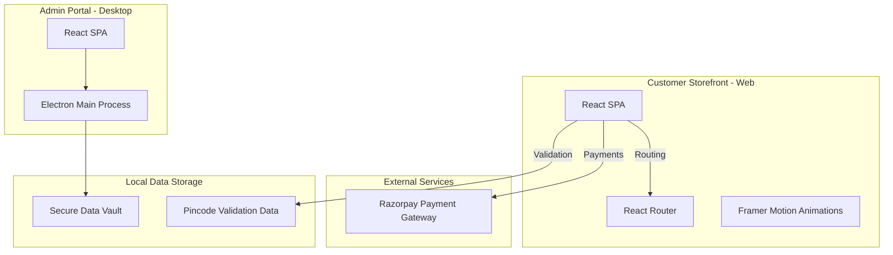

# Architecture

## High-Level Architecture

The Mother Nature platform consists of a modern web architecture separated into a customer-facing storefront and an administrator management portal. 

## Components

### 1. Storefront (Web)
- **Framework:** React + Vite
- **Routing:** React Router DOM
- **UI/UX:** Custom CSS + Framer Motion for micro-interactions
- **Key Logic:**
  - `App.jsx`: Main application wrapper and state provider.
  - `CloudService.js`: Interface for external interactions and potential backend sync.
  - Pincode validation logic parsing local datasets.

### 2. Admin Portal (Desktop)
- **Framework:** Electron + React
- **Entry Points:**
  - `electron-main.cjs`: Handles desktop integration, window management, and secure local file access.
  - `src/`: React frontend for the admin UI.
- **Key Logic:**
  - `update_app.js`: Auto-update handling for the Electron application.

### 3. Data Management
Currently, the application relies on local CSV/JSON files (`pincode.csv`, `pincodes.json`, `otp_vault.json`) for validation and security, which is optimized for fast local retrieval.

### 4. Third-Party Integrations
- **Razorpay**: Used for all checkout and payment processing directly on the client side via their standard JS SDK.
